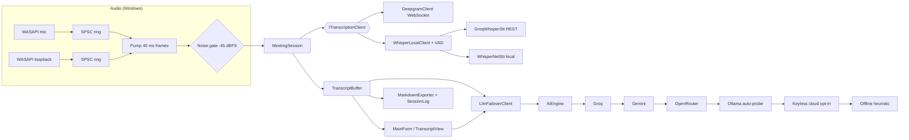

# Architecture

| Namespace | Responsibility | Platform |
|---|---|---|
| `Audio` | NAudio capture, device-change recovery, local Whisper.net model | Windows |
| `Session` | `IAudioSource`, SPSC ring, `FrameAssembler` (fixed frames, idle-loopback silence), noise gate, `MeetingSession`, transcript buffer, speaker turns, Markdown export/session log, recovery backoff | neutral |
| `Transcription` | `ITranscriptionClient`, Deepgram WebSocket client, VAD segmenter + `WhisperLocalClient`, Groq STT, cloud→local fallback, `CompositeLocalStt` (instant Windows speech -> Whisper) | neutral |
| `Ai` | Prompt templates, SSE streaming `LlmClient` (OpenAI-compatible + Anthropic, vision), `LlmFailoverClient`, `AiEngine` (zero-config chain), `OllamaProbe`, `OfflineAssistant` | neutral |
| `Logging` | Structured, redacting, size/retention-capped file logger | neutral |
| `Config` | `AppConfig`, `ConfigStore` (atomic save, DPAPI keys, migration/clamping) | Windows |
| `Native` | Win32 P/Invoke: display affinity, hotkeys, drag, hit-testing | Windows |
| `UI` / `MainForm` | Fluid `TableLayoutPanel` layout, settings, transcript view, screen capture, WebView2 browser | Windows |

## Key design decisions
- **Lock-free audio path.** Capture callbacks (one producer per device generation) write to an SPSC ring; one pump thread reads. Network stalls or reconnects can never block WASAPI threads. Device recovery swaps in a *new* ring per generation, so a ring never has two producers.
- **Streaming ASR contract.** `ITranscriptionClient` accepts PCM16 chunks, never blocks, drops oldest audio when offline (bounded), and raises `Transcript`, `StateChanged`, `Error`. Engines are interchangeable; the UI chains them (Deepgram → Groq → local).
- **Failover semantics.** Retry 429/5xx with exponential backoff + jitter → fail over to the next provider with a cooldown → never switch providers once a token has streamed → first-token (10 s) and total (2 min) timeouts.
- **Privacy.** No backend. Keys are DPAPI-encrypted per Windows user; logs redact keys/tokens; screenshots stay in memory; the window is excluded from capture via `SetWindowDisplayAffinity(WDA_EXCLUDEFROMCAPTURE)` and re-verified every 3 s.
- **Testability.** Everything platform-neutral is compiled directly into the xUnit project (`tests/TransparentNotepad.Tests`), so the suite runs without Windows or WinForms.

- **Zero-key stack.** `CompositeLocalStt` serves speech instantly via the Windows recognizer while the Whisper model downloads; `AiEngine` falls through configured keys -> Ollama -> opt-in keyless cloud -> offline heuristic, so the app always responds.
- **Stealth.** Capture exclusion is applied through one method (`Win32.ApplyCaptureExclusion`) to every window we own; `WS_EX_NOACTIVATE` is cleared only while the user types and restored on leave.
- **Idle loopback.** WASAPI loopback raises no data while the system is silent; the pump runs on a wall clock and `FrameAssembler` zero-fills idle rings, so endpointing always sees the silence that ends an utterance (covered by `AudioLoopbackSilenceFlushTests`).
